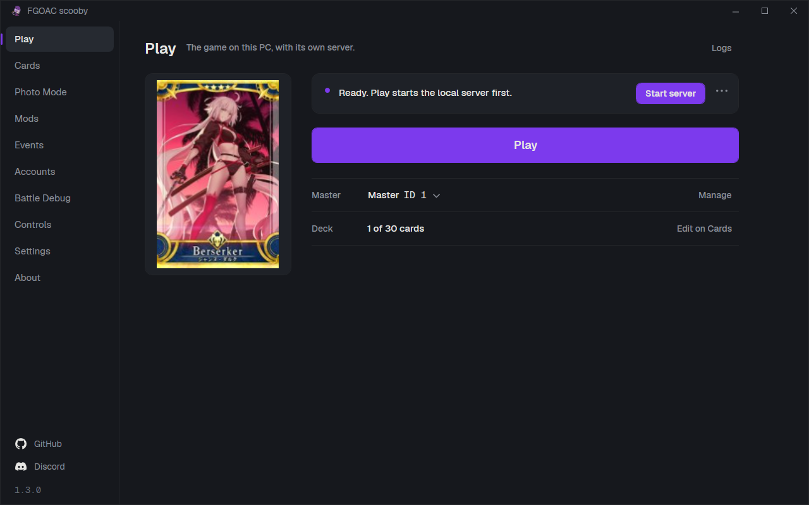
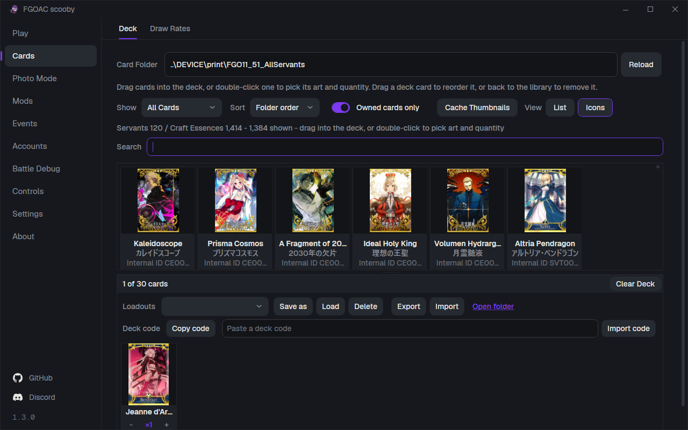
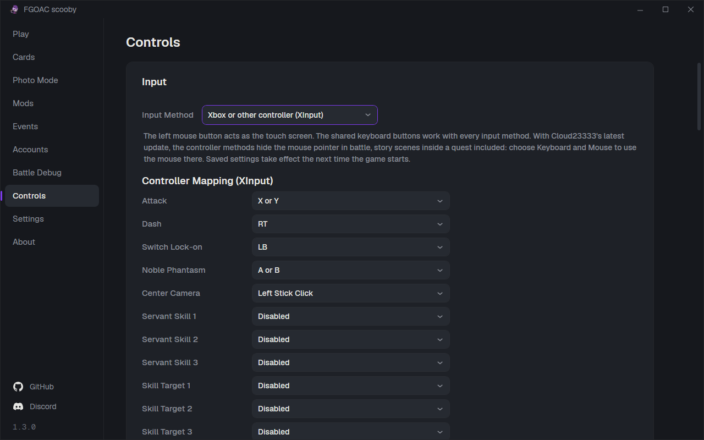
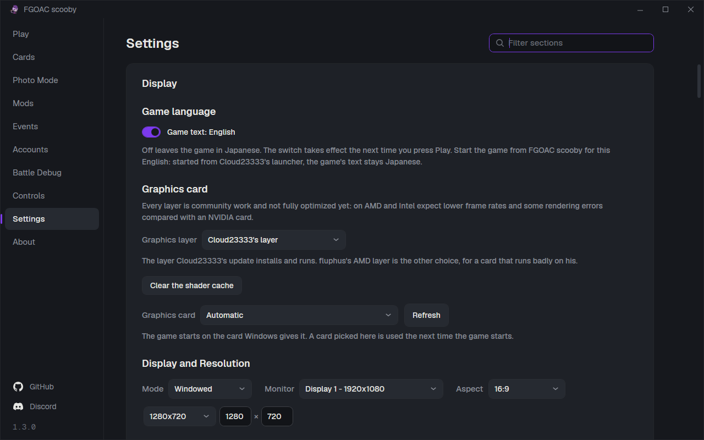

<div align="center">

# FGOAC scooby

**Fate/Grand Order Arcade, in English, on your own PC.**

[](https://github.com/githubuser420x/FGOAC-scooby/releases/latest)
[](https://github.com/githubuser420x/FGOAC-scooby/releases)
[](LICENSE)
[](https://discord.gg/RNT6KzEgk)



</div>

FGOAC scooby is a fan-made English patch and launcher for the FGO Arcade local platform. It puts the
game itself into English - menus, tutorial, story, battle screens, shops, help - and replaces the
platform's Chinese front end with an English one that starts the local server, manages your Master
account, and builds your thirty-card deck from the real card art. It is not a game download and it
carries no game files: it is applied on top of an FGO Arcade local platform install you already have.

## What you need

| | |
| --- | --- |
| The game | An existing **FGO Arcade local platform V1.01 or V1.02** install (Cloud23333's package), with or without his latest update - the folder that holds `App` and `Server`. V1.02 is the one to be on: it fixes ERROR 4102, the blank Servant records and the sync error after enhancing a Servant |
| OS | Windows 10 or 11, 64-bit |
| GPU | NVIDIA on a current driver. AMD and Intel: a compatibility layer, picked under Graphics layer on Settings > Display. Cloud23333's layer from his latest update is the default, on his update and without it; the layer FGOAC scooby shipped with 1.1.0 and fluphus's AMD layer are there to choose. All are community work and not fully optimized yet, so expect lower frame rates and some rendering errors than on NVIDIA |
| CPU | Intel Core 3rd generation (2012) or newer, or any Ryzen. Pentium and Celeron chips before the 12th generation lack F16C, an instruction set the game uses, and stop with 0xC000001D at start |
| Drive | Any drive **except E: or Y:** - see the table further down |
| Rights | Administrator: one Windows prompt when the launcher starts |

.NET and Python are not needed. The launcher carries its own runtime, and the platform brings its own
Python.

## Install

1. Download the latest release zip and unzip it into your FGO Arcade folder, beside `App` and `Server`.
2. Run **FGOAC scooby.exe** and click **Yes** on the Windows permission prompt.
3. Press **Play**. The game takes about a minute to reach the title screen.

The first start does the rest on its own: it installs the English files, checks the game can write to
its own folders, allows the game and the local server through Windows Firewall, creates the account
**Master** with a full Servant and Craft Essence roster, and sets the display to windowed 1280x720 on
your main monitor. Later starts go straight to Play.

Already installed? When a newer version is out the Status on Play says so, and **Install** beside it
downloads it, applies it and restarts the launcher; the Status then says **Updated to** the new
version, and **What's new** beside it lists what changed. Your accounts, decks, settings and graphics
layer stay as they are. Unzipping a newer release over the folder does the same.

[`docs/GUIDE_EN.pdf`](docs/GUIDE_EN.pdf) is the full player guide: getting Servants, controls, a
sortie step by step, the exchange shops and troubleshooting.

## What works

- **The game text** - over 65,000 translated rows: story, quests, Servant and Craft Essence
  profiles, skills, items, missions and every menu. Names follow the English release.
- **The game artwork** - over 220 rebuilt sprite archives: title, tutorial, terminal, formation,
  battle HUD, results, shops, synthesis, present box, master missions, rankings, help, title editor.
- **Offline single player, end to end** - the tutorial, solo sorties, the terminal, the exchange
  shops, synthesis, My Room, rankings and the title editor.
- **The launcher**, every page, with the official English card names and Craft Essence effects.
- **The in-game summon** - it draws from the local server's pool with the weights from the Draw Rates
  page. You do not need it for a roster: the Account page grants a full one in one click, and the
  card library holds all 1,384 cards.
- **Deck loadouts and draw-rate presets** - save, load and delete as many as you like from the Cards
  and Deck and Draw Rates pages, and Export/Import to send one to another player as a small file.
  A deck also travels as a deck code, one line of text: Copy code, paste it in chat, and the other
  player pastes it into the box beside it and presses Import code.

## What does not work

- **No online service.** Everything runs against the local server on your PC.
- **Intel and laptop graphics not confirmed.** Whether Cloud23333's layer runs the game on Intel
  integrated graphics (Iris Xe), Intel Arc and Ryzen laptop graphics has not been confirmed.
- **Some artwork is still Japanese** - event and boss banners, parts of the event screens and shops,
  and some buttons and labels. They are pictures rather than text; the game's text is English.

## The launcher

| Page | What it does |
| --- | --- |
| **Play** | Play and Stop Game on the server on this PC, the Status sentence with the next step beside it (Start server, Stop server, Install, What's new), Manage beside the Master line for the accounts page, open the logs, Save a report in the Status menu, and live readouts for the server, the selected Master and the deck. The page to leave open while the game runs. |
| **Accounts** | Also opened with Manage beside the Master line on Play. The selected local account's details, its summon results, and create, select and delete Master accounts, and grant one of them a full Servant, Craft Essence and item roster in a single click, with levels, bond, costumes and clear rewards. With Cloud23333's latest update, Export all and Import move every local account through one file, the one his launcher uses. |
| **Cards** | Deck and Draw Rates. The card library and the deck editor, searchable by official English name, with Craft Essence effects in FGO NA phrasing. Each deck card has - and + for its copies and Remove all copies; each saved loadout has a button above the deck that loads it. Copy code and Import code share the deck as one line of text. The deck is sent to the game every time you press Play. |
| **Photo Mode** | The photo mode panel: free camera, depth of field, expressions, poses and the Servant model, live while the game runs. |
| **Mods** | The MOD folder of Cloud23333's latest update, App\1_MOD. |
| **Events** | Which limited-time events the server on this PC offers: with Cloud23333's latest update his event switches, grouped by edition and kind and in an order of your own; on the earlier game the Banners patch. |
| **Battle Debug** | Battle test switches for local play, including Stop the battle timer. |
| **Controls** | Input - keyboard, an Xbox or other controller (XInput) or a PlayStation 5 controller (DualSense), with dead zone, rumble, a controller test and the Operator menu keys (F1, F2) switch for ERROR 8404; with Cloud23333's latest update also his keyboard battle mode with its mouse camera, his controller camera, card selection with the controller, his controller mouse, and a switch that keeps the mouse inside the game window. Bindings - a key, controller button or chord that taps a button on the game's screen. Cursor - size, outline, position and the mouse button that taps the screen (Tap with). |
| **Settings** | Display - monitor, resolution, aspect ratio, frame rate, display mode, a graphics card pick, the Graphics layer for AMD and Intel graphics (Cloud23333's layer by default, the 1.1.0 layer or fluphus's AMD layer), and Widescreen: the picture fitted to screens that are not 16:9, with the full width kept on 16:10 and 4:3, and the HUD and menus at the screen edges (being tried, off by default); with Cloud23333's latest update also fog, reflections, draw distance, ultra-low quality and the treasure chests' size and opacity. Battle effects - hide the dark or white screen during Noble Phantasms, hide the white screen flash, and an Effect opacity slider for how strongly the game's own battle effects are drawn. Audio. PC play - the continue window and popups wait for you instead of counting down; three more switches, off until tried in the game, remove the GP purchase screen, make story pages wait for a press, and remove the menu countdown. Local server - the local server and its settings. Diagnostics and Help with every game error code and its fix. The box at the top filters the sections. |
| **About** | The version, Check for updates, the links to GitHub and Discord, and the credits. |

### Everyday use

- **Play.** Play plays on the server on this PC. The Status sentence says where things stand -
  whether the local server is running - or, in one sentence, why Play cannot start yet.
- **The Master menu.** Click the Master line on Play: it lists your local accounts to switch between,
  with New account at the bottom; Manage beside the line opens the accounts page.
- **Deck codes.** Copy code on Cards puts the deck on the clipboard as one line of text to paste in
  chat. Paste a code into the box beside it and press Import code: the deck loads and is saved as a
  new loadout, never over one you have.
- **Save a report.** Open the Status menu, the button at the end of the Status line on Play, and
  choose Save a report. It saves one zip, on the Desktop unless you pick another place, with your
  card number taken out. Nothing is uploaded: you attach the file yourself.
- **Bindings.** Controls > Bindings ties a key, a controller button or a combination such as Ctrl+F5
  to a button on the game's screen: click a box and press what you want.
- **Camera.** With Cloud23333's latest update the camera is his, set on Controls: Battles
  in free camera, his keyboard battle mode, turns the view with the mouse in battle, and Controller
  camera turns it with the right stick, with a lock-on button. Keep the mouse inside the game window,
  also on Controls, holds the pointer in the window while the game is in front. Changes count from
  the next Play.
- **PC play.** Settings > PC play: after a lost quest Continue and Withdraw wait for you, and popups
  stay open until you answer them; both are on. No GP purchase screen, Story pages wait for you and
  No menu countdown are off until they have been tried in the game; turn them on to try them.
  Changes count from the next Play.
- **Widescreen.** Settings > Display > Widescreen: Widescreen picture fits the picture to screens
  that are not 16:9, and Full width on taller screens keeps the whole width on 16:10 and 4:3; both
  are on. HUD and menus at the screen edges is off while it is being tried.
- **Logs.** Logs on Play opens the drawer, which shows one log at a time: Launcher, Game or
  Server.
  It remembers your choice.

It keeps itself up to date: the launcher asks GitHub Releases whether there is a newer version and
offers to fetch and apply it, so a translation fix reaches you without a reinstall.

<p align="center">
  
  
  
</p>

## If something goes wrong

Open **Settings > Diagnostics and Help** first. It lists every game error code with the fix, and the
answer is usually there.

| What you see | What it means | What to do |
| --- | --- | --- |
| **ERROR 4102** | The game cannot reach the local server. On V1.01 it also happens when the computer name equals the user name. | Start the server from the Play page, wait for it to report ready, then press Play again. If it keeps happening on V1.01, update to Cloud23333's V1.02, which fixes it. |
| **ERROR 8404** at boot | The game's own Startup Mode was saved as Satellite (Sub Unit), so it waits for a main unit that does not exist. | Turn on **Operator menu keys (F1, F2)** on the **Controls** page and press Play, then on the error screen press **F1** for the Game Test Menu (**F2** moves the arrow, **F1** confirms), open **Game Settings**, set **Startup Mode** to **Main Unit**, then choose **Exit**. The next boot reaches the title. |
| **Cannot use Aime card** at the title screen | The game's first message to the local server timed out on that boot. | Close the game, check that the server shows ready on the Play page, and press Play again. |
| **0x80131515** at Play, or the server stops with a message about `FGO_Runtime.dll` | Windows marked `App\FGO_Runtime.dll` as downloaded from the internet, and PowerShell refuses to load a file with that mark. | The launcher clears the mark itself. If it comes back, right-click the file, open Properties and tick **Unblock**. |
| **"Some of the files the game needs are missing"** when the launcher starts | The zip was unzipped somewhere other than the game folder, or the folder never had Cloud23333's V1.01 update. | Unzip into the folder that holds `App` and `Server`, so `FGOAC scooby.exe` sits beside them, and apply V1.01 or V1.02 first. |
| **The game window opens and closes again** (exit code 22) although the environment check passes | Not pinned down yet. | Try windowed 1280x720 on the primary monitor. When reporting it, attach `logs\ago-crash-*.dmp` and say which graphics card and driver version you have. |
| **"Update failed" at the end of Cloud23333's V1.02 updater**, after it printed that the patch files are installed | His files are in place. Only the last step stopped, a recovery of Servants enhanced before V1.02, because his bundled Python environment points at a folder that exists only on his PC. | Run FGOAC scooby as usual. If you had enhanced Servants before V1.02 and want them recovered, run once from the game folder: `Server\python\python.exe Server\tools\repair_fgo_grail.py --logs logs --report logs\grail-recovery.json --apply` |
| **ERROR 4104** | The install is on drive **E:** or **Y:**. The game's own file hook sends every path on those drives to the cabinet data mount, so it cannot open its own files. | Move the whole game folder to any other drive. |
| **ERROR 4105**, about ninety seconds after launch | The game was not started as administrator. | Click **Yes** on the Windows permission prompt when the launcher starts. |
| **0xC0000005**, a few seconds after launch | Windows Defender **Controlled Folder Access** is blocking the game from writing its own files. | Allow the game folder, or `App\ago.exe`, under Windows Security, Virus and threat protection, Ransomware protection. |
| **A black screen at launch** | Almost always the NVIDIA driver rather than the patch. | Update the driver and try again. |
| **The game hangs at a black screen on the very first launch** | A Windows Firewall prompt is waiting behind the game window. The launcher normally creates those rules itself, but a company policy or a security suite can stop it. | Look in the task bar for the prompt and allow both `Server\python\python.exe` and `App\ago.exe`. |
| **The main menu misbehaves right after the tutorial** | A known quirk of the tutorial-to-main-menu handoff. | Restart the game once. |
| **Exit code 22 with 0xC000001D** right after start | The CPU has no F16C. | Not fixable on that CPU. |
| **ERROR 6401** at start with a controller or a USB device | Not pinned down yet. | Players report this goes away with Windows USB selective suspend turned off (Power Options > Change plan settings > Change advanced power settings > USB settings). |
| **The launcher says the folder never had V1.01**, or that fgohook.dll is still 11.00 | Cloud23333's V1.01 update was never applied, or it stopped partway through. | Unzip Cloud23333's V1.02 over the game folder and let it overwrite, then start the launcher again. |
| **No cards after the first run**, ERROR 0949, or ERROR 0087 with the game on a Storage Spaces or ReFS drive | A RAR part failed to extract, or the drive refuses the game's save writes. | Re-extract the base game and let it overwrite; keep the install on a plain NTFS drive. |
| **Google Drive renamed the RAR parts** (part1-003 and so on) | Google Drive renames matching downloads instead of keeping their original part numbers. | Rename them back to FGOA_Cloud23333.part1.rar, part2.rar ... and unzip the small zip to get part5.rar before extracting part1. |
| **Download links from 123 Pan** | Not Cloud23333's. | Use the links in his Bilibili description only. |

To report a problem, open an issue and say which screen you were on and what you expected. Attach
the report from **Save a report** in the Status menu on Play: one zip, named with the date, saved
where you choose, holding the logs from the `logs` folder next to `App` (`fgo-last-launch.log`,
`fgozh.log`, `server-control.log`, `artemis-stderr.log`, `mariadb.log`, `environment-check.txt` and
the others), the settings, the newest crash dumps and a list of what is inside. Your card number is taken out
of it. It is only saved on your PC:
the launcher never uploads it and has no telemetry. `server-control.log` holds today's lines; earlier
days are `server-control-<date>.log`, kept for 14 days.

## Building from source

You need the .NET SDK (10.x is what this is developed on) and Windows 10 or 11 x64. Everything else -
the .NET 6 reference and runtime packs, and the one package dependency - is restored from nuget.org
on the first build.

```
build.cmd                     compile check only
publish.cmd                   self-contained single file, into dist\
deploy.cmd <install root>     copy the published launcher into an install
```

`publish.cmd` writes `dist\FGOAC scooby.exe`. Expect zero warnings and zero errors.

[`docs/DEVELOPING.md`](docs/DEVELOPING.md) explains where `src\` comes from, the compile fixes the
decompile needs, what the translation must never change, and how to re-derive the build when the
author ships a new version. [`CONTRIBUTING.md`](CONTRIBUTING.md) has the house style.

## Releases

A release is one zip built from this repository and the English game files in an install, with a
SHA-256 manifest generated from the same bytes that ship. The updater in the launcher reads
`releases/latest`, so a release only reaches players once it is published and not marked
pre-release.

```
publish.cmd
package.ps1 -GameRoot <install root> -AddOnDll <build folder>\fgoacaddon.dll
```

That writes `release\FGOAC-scooby-vX.Y.Z.zip` and `FGOAC-scooby-vX.Y.Z.zip.sha256`. Sign the zip
with `tools\Sign-Release.ps1`, which writes `FGOAC-scooby-vX.Y.Z.zip.sig` beside it. Tag the commit
`vX.Y.Z`, publish a GitHub release on that tag, and upload all three files as assets. The updater
takes the zip only under the exact name its tag gives and needs its `.zip.sig`: one or more
signature lines, of which one has to verify under the release keys built into the launcher, or
nothing is installed. The `.zip.sha256` is only for launchers 1.2.0 and older, which check the zip
against it.

## Credits

**Cloud23333** wrote the FGO Arcade local platform: the server package, the front end
(`FGOLocalPlatform`) that FGOAC scooby is built from, and the file hook this patch loads its English
through. None of this exists without that work, and his package is free - if anyone sold it to you,
ask for your money back. The **FGO Arcade wiki** and **Atlas Academy** are where the official English
names of Servants, Craft Essences, skills and items come from, so the game and the launcher call
everything what the English release calls it. **fluphus** wrote the AMD layer
[fgo-arcade-amd-shim](https://github.com/fluphus/fgo-arcade-amd-shim), parts of which Cloud23333's
graphics layer builds on. **Fate/Grand Order Arcade is Sega's and TYPE-MOON's**;
they own the game. This is a fan translation applied to files you already have, it is not sold, and
it carries no game files of its own.

Released under the [MIT licence](LICENSE).
